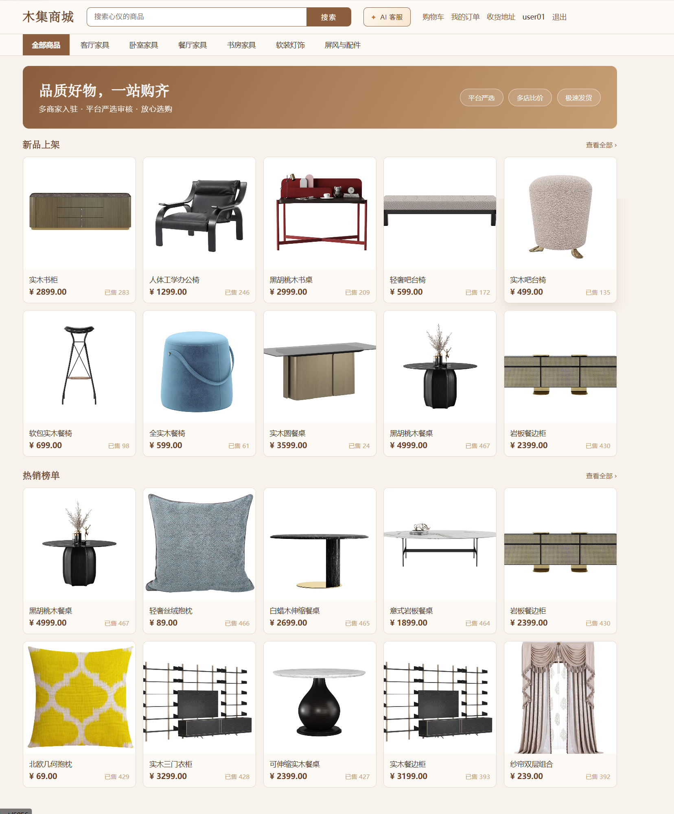

# 木集商城 · 多商家 B2B2C 家具电商平台

> 前后端分离 · Spring Boot 3 单体多模块 + 双前端工程
>
> 覆盖「买家 / 入驻商家 / 平台管理员」三类角色，完整实现从商品浏览到评价售后的交易闭环，并在其之上落地语义搜索、AI 文案、评价摘要与 RAG 智能导购等 AI 能力。



---

## 目录

- [项目简介](#项目简介)
- [功能清单](#功能清单)
- [技术栈](#技术栈)
- [系统架构](#系统架构)
- [仓库结构](#仓库结构)
- [快速开始](#快速开始)
- [演示账号](#演示账号)
- [接口与数据库文档](#接口与数据库文档)
- [测试](#测试)
- [里程碑](#里程碑)
- [说明](#说明)

---

## 项目简介

木集商城是一个面向家具品类的多商家入驻电商平台（B2B2C）。平台允许商家提交入驻申请、发布商品，平台管理员审核商家与商品；买家可以跨店加购、下单（自动按店铺拆单）、使用支付宝沙箱支付、查看高德地图物流轨迹、确认收货、申请退款与发表评价。

项目以**交易闭环**为主线，以**AI 能力**为增强：

| 能力 | 说明 | 降级策略 |
|---|---|---|
| 语义搜索 | 关键词召回 + 向量召回，RRF 融合排序 | 关闭开关即纯关键词搜索 |
| AI 商品文案 | 4 种风格结构化文案生成，一键回填 | JSON 非法 → 扰动重试 → 模板拼装 |
| AI 评价摘要 | 评价优点/缺点/人群/标签总结 | 超时/关闭 → 统计摘要（评分分布 + 高频标签） |
| AI 智能导购（RAG） | 按真实评价检索证据，大模型在候选集内重排并给理由 | 异常/配额超限 → 评分 × 评价数的规则排序 |

- 买家端：`mall-web/buyer-web`（http://localhost:5173）
- 商家/平台工作台：`mall-web/admin-web`（http://localhost:5174）
- 后端 API：`mall`（http://localhost:8080）

## 功能清单

### 买家端
- 注册 / 登录 / 图形验证码 / JWT 刷新与退出
- 首页推荐、全部商品、分类筛选、关键词搜索、AI 语义搜索
- 商品详情（SKU 规格、库存、评价区、AI 评价摘要）
- 购物车（Redis Hash）、收货地址（高德地址识别校验）、结算下单
- 支付宝沙箱支付、支付结果回跳、订单列表 / 详情、取消订单
- 物流轨迹（纯文本 / 高德地图折线轨迹）、确认收货
- 退款申请与进度查询
- 订单评价（星级、正文、最多 6 图、匿名）、我的评价状态
- 「✦ AI 客服」按评价推荐商品（入口位于顶部搜索框右侧）

### 商家端（工作台）
- 商家入驻申请、店铺信息维护、营业 / 休店
- 商品发布 / 编辑 / 上下架（含 AI 文案生成）、SKU 与规格
- 订单管理（待发货 / 发货 / 物流推进）、退款审核
- 本店评价查看与一次性回复
- 店铺经营数据概览

### 平台端（管理后台）
- 管理员账号 / 角色 / 权限（RBAC）、动态菜单
- 商家入驻审核、商家冻结 / 启用
- 商品审核、全平台商品管控与违规下架
- 类目管理（家具类目树）
- 全平台评价审核（隐藏 / 恢复，评分同步重算）
- 审计员账号（只读审计角色）

## 技术栈

**后端**：Spring Boot 3.3.4 · JDK 17 · Maven 多模块 · MyBatis-Plus 3.5.7 · MySQL 8.0 · Redis 7 · MongoDB 6 · JWT（jjwt 0.12.6）· 支付宝沙箱 SDK · 高德 Web 服务 · DeepSeek（OpenAI 兼容协议）· 百炼 Embedding（可选）

**前端**：Vue 3.5 · TypeScript · Vite 8 · Pinia · Vue Router · Element Plus（工作台）· 原生 CSS（买家端）· 高德 JS API · wangEditor

**工程化**：Docker Compose（Redis / MongoDB）· Spring Boot Test + MockMvc + Mockito · Vitest · 分模块 DDL 与接口文档

## 系统架构

```
┌─────────────────────────────┐      ┌─────────────────────────────┐
│  buyer-web (5173)           │      │  admin-web (5174)           │
│  买家商城 / 评价 / AI 客服   │      │  商家工作台 / 平台管理后台   │
└──────────────┬──────────────┘      └──────────────┬──────────────┘
               │  /api 代理                          │  /api 代理
               └───────────────┬─────────────────────┘
                               ▼
                 ┌──────────────────────────┐
                 │ mall-gateway-web : 8080  │  Spring Security + JWT 过滤链
                 └────────────┬─────────────┘
        ┌────────────┬────────┼────────────┬────────────┐
        ▼            ▼        ▼            ▼            ▼
   mall-order   mall-product  mall-admin  mall-merchant  mall-user
        │            │            │            │            │
        └────────────┴──────┬─────┴────────────┴────────────┘
                            ▼
                    mall-security（JWT / 权限 / 验证码）
                            ▼
                       mall-common（R / 异常 / 序列化）
                            ▼
              mall-ai（AI 网关 / Provider / 向量库 / RRF）
        ┌───────────────┬───────────────┬────────────────┐
        ▼               ▼               ▼                ▼
     MySQL 8          Redis 7        MongoDB 6      第三方服务
  业务数据/RBAC    token/购物车/缓存  商品详情/物流轨迹  支付宝沙箱/高德/DeepSeek
```

## 仓库结构

```
skiil_creat
├─ mall/                     # 后端（Spring Boot 3 多模块）
│   ├─ mall-common/          # 统一响应、异常、雪花 ID 序列化
│   ├─ mall-security/        # JWT、权限、验证码、TokenStore
│   ├─ mall-user/            # 买家域
│   ├─ mall-merchant/        # 商家域（入驻申请、店铺）
│   ├─ mall-admin/           # 平台域（RBAC、审核、类目）
│   ├─ mall-product/         # 商品域（SPU/SKU、搜索、向量生成）
│   ├─ mall-order/           # 交易域（购物车、订单、支付、物流、退款、评价）
│   ├─ mall-ai/              # AI 网关（Chat / Embedding / VectorStore / RRF）
│   ├─ mall-gateway-web/     # 启动模块（8080）
│   ├─ docker/               # MySQL 初始化 DDL + 种子
│   └─ docs/                 # 数据库与接口文档
├─ mall-web/                 # 前端（Vue 3 双工程）
│   ├─ buyer-web/            # 买家端（5173）
│   └─ admin-web/            # 商家 + 平台工作台（5174）
└─ docs/images/              # 三端界面截图
```

## 快速开始

### 0. 环境要求

| 依赖 | 版本 |
|---|---|
| JDK | 17 |
| Maven | 3.8+ |
| Node.js | 18+ |
| MySQL | 8.0 |
| Docker | 可选（用于 Redis / MongoDB） |

### 1. 启动中间件

```bash
cd mall
docker compose up -d        # 启动 mall-redis(6379) + mall-mongo(27017)
```

> 开发期 MySQL 使用本机实例（`localhost:3306`，库 `mall`）。也可用 `docker compose --profile deploy up -d` 启动容器化 MySQL。

### 2. 初始化数据库

新建 `mall` 库后，按文件名顺序执行 `mall/docker/mysql/init/` 下的 SQL（全新库一次执行即可）：

```bash
mysql -uroot -p123456 mall < docker/mysql/init/01-auth-schema.sql
# 依次执行 02 ~ 11（含 RBAC、商品、订单、发货、退款、AI 向量、评价）
```

### 3. 配置环境变量（密钥不入库）

在 `mall/` 下准备本地 env 文件（均已 `.gitignore`），或直接设置进程环境变量：

| 变量 | 说明 | 必填 |
|---|---|---|
| `MALL_JWT_SECRET` | JWT 密钥（HS512，≥64 字节） | 生产必填 |
| `MALL_ALIPAY_APP_ID` / `MALL_ALIPAY_PRIVATE_KEY` / `MALL_ALIPAY_PUBLIC_KEY` | 支付宝沙箱四要素 | 支付/退款必填 |
| `MALL_ALIPAY_NOTIFY_URL` | 支付异步回调地址（需公网可达） | 支付必填 |
| `MALL_AMAP_WEB_KEY` | 高德 Web 服务 Key（地理编码 + 路线规划） | 地图物流必填 |
| `MALL_LOGISTICS_PROVIDER` | `manual`（默认）/ `amap` | 可选 |
| `MALL_AI_ENABLED` | `true` / `false`（默认 false） | 可选 |
| `MALL_AI_PROVIDER` | `mock` / `openai-compat` | 可选 |
| `MALL_AI_BASE_URL` / `MALL_AI_API_KEY` / `MALL_AI_CHAT_MODEL` | Chat 模型配置（DeepSeek 默认） | AI 必填 |
| `MALL_EMBED_ENABLED` / `MALL_EMBED_API_KEY` / `MALL_EMBED_MODEL` | 向量模型（百炼 text-embedding-v3） | 语义搜索必填 |
| `MALL_AI_SEARCH_MODE` | `keyword` / `hybrid` / `auto` | 可选 |

### 4. 启动后端

```bash
cd mall
mvn clean package -DskipTests
java -jar mall-gateway-web/target/mall-gateway-web-1.0.0-SNAPSHOT.jar
# 健康检查：http://localhost:8080/api/ping
# Swagger UI：http://localhost:8080/swagger-ui/index.html
```

### 5. 启动前端

```bash
cd mall-web/buyer-web && npm install && npm run dev     # http://localhost:5173
cd mall-web/admin-web && npm install && npm run dev     # http://localhost:5174
```

> 两个前端均将 `/api` 与 `/static` 代理到 `http://localhost:8080`；本地商品图片通过后端 `/static/**` 提供。

## 演示账号

| 角色 | 账号 | 密码 | 入口 |
|---|---|---|---|
| 买家 | `user01` ~ `user04` | `test123` | http://localhost:5173 |
| 商家 | `merchat01` ~ `merchat04` | `test123` | http://localhost:5174（商家 tab） |
| 平台管理员 | `admin` | `admin123` | http://localhost:5174（管理员 tab） |
| 审计员 | `auditor` | 见 `docker/mysql/init` 种子 | http://localhost:5174（管理员 tab） |

> 演示数据包含 4 家店铺、60 个家具商品、480 条评价与已完成订单，可直接体验评价与 AI 导购。

## 接口与数据库文档

| 文档 | 说明 |
|---|---|
| [认证接口](mall/docs/api/m1-auth-api.md) | 注册 / 登录 / 刷新 / 登出 / 验证码 |
| [商品域接口](mall/docs/api/m2-product-api.md) | 上传、入驻、店铺、类目、商品、审核 |
| [交易域接口](mall/docs/api/m3-order-api.md) | 地址、购物车、结算、订单 |
| [支付接口](mall/docs/api/m4-payment-api.md) | 支付宝沙箱支付与回调 |
| [物流接口](mall/docs/api/m5-logistics-api.md) | 发货、轨迹、确认收货 |
| [退款接口](mall/docs/api/m6-refund-api.md) | 申请、审核、退款、重试 |
| [物流地图接口](mall/docs/api/m7-logistics-map-api.md) | 高德路线、轨迹插值、降级 |
| [AI 文案接口](mall/docs/api/m9-ai-copy-api.md) | 4 风格文案生成 |
| [评价与 AI 推荐接口](mall/docs/api/m10-review-api.md) | 评价、摘要、回复、审核、AI 导购 |
| [数据库设计](mall/docs/db/) | 各里程碑 DDL 与 Redis Key 设计 |

## 测试

```bash
# 后端全量测试（单元 + 集成）
cd mall && mvn test

# 前端组件测试
cd mall-web/buyer-web && npm test
cd mall-web/admin-web && npm test
```

## 里程碑

| 里程碑 | 内容 | 状态 |
|---|---|---|
| M1 | 认证骨架、JWT、RBAC 基础 | 完成 |
| M2 | 商家入驻、店铺、商品、类目、文件上传 | 完成 |
| M3 | 地址、购物车、结算、跨店拆单、订单状态机 | 完成 |
| M4 | 支付宝沙箱支付与回调 | 完成 |
| M5 | 发货、物流轨迹、确认收货 | 完成 |
| M6 | 退款售后与订单状态扩展 | 完成 |
| M7 | 高德地图物流轨迹可视化 | 完成 |
| M8 | AI 网关、语义搜索（向量 + RRF） | 完成 |
| M9 | AI 商品文案生成 | 完成 |
| M10 | 评价体系、AI 评价摘要、RAG 智能导购 | 完成 |

## 说明

- 支付使用**支付宝沙箱**，不涉及真实资金。
- 第三方密钥（支付宝、高德、DeepSeek、百炼）均通过本地环境变量注入，仓库内不保存任何真实密钥。
- 商品图片来源于公开家具素材，仅用于学习演示。
- 三端界面截图位于 `docs/images/`。
- 更多数据库与接口细节见 `mall/docs/`。
