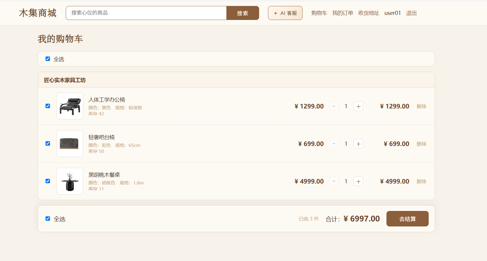
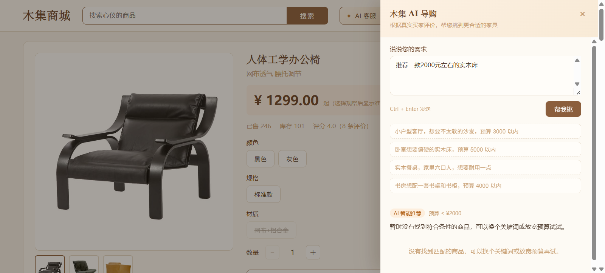
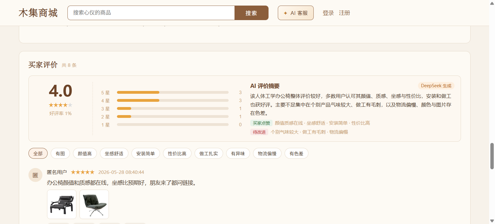
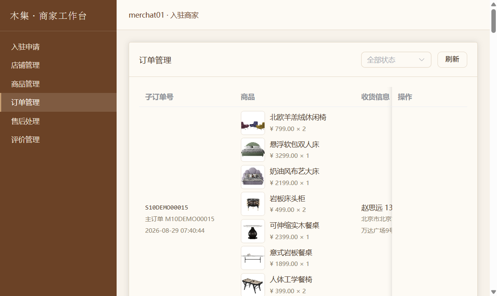
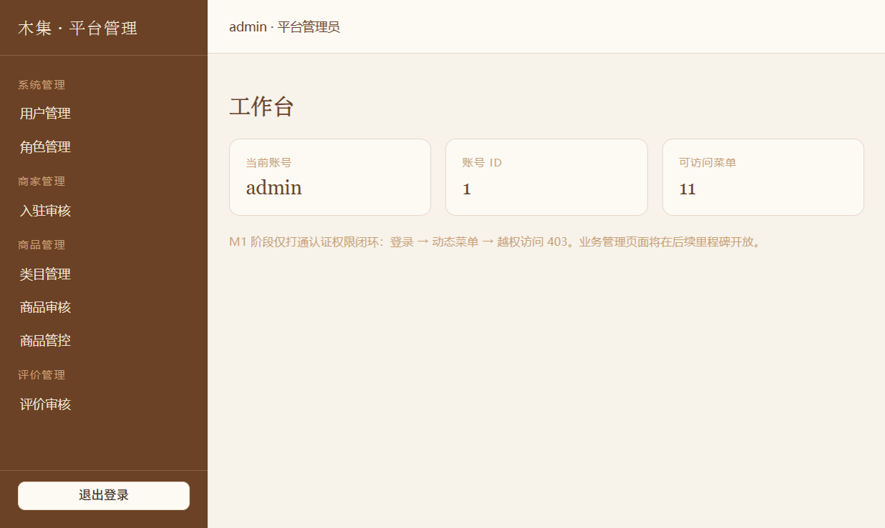

# mall-web · 木集商城前端

> Vue 3.5 · TypeScript · Vite 8 · Pinia · Vue Router
>
> 双前端工程：买家商城（buyer-web，5173）+ 商家/平台工作台（admin-web，5174），共用同一后端 API（8080）。

## 工程结构

```
mall-web
├─ buyer-web/           # 买家端：家具商城、购物车、订单、评价、AI 客服
│   ├─ src/api/         # 接口封装（auth / product / order / review ...）
│   ├─ src/components/  # BuyerHeader、ProductReviews、AiAssistant、LogisticsMap ...
│   ├─ src/views/       # Home、Products、ProductDetail、Cart、Checkout、Orders ...
│   └─ vite.config.ts   # 5173，/api 与 /static 代理到 8080
└─ admin-web/           # 工作台：商家端 + 平台管理端
    ├─ src/api/         # 商家 / 平台接口
    ├─ src/views/admin/     # 平台：入驻审核、商品审核、类目、评价审核、用户/角色
    ├─ src/views/merchant/  # 商家：店铺、商品、订单、退款、评价
    ├─ src/utils/merchant-guard.ts  # 商家菜单与路由守卫
    └─ vite.config.ts   # 5174，/api 与 /static 代理到 8080
```

## 运行

```bash
# 买家端
cd buyer-web
npm install
npm run dev        # http://localhost:5173

# 商家 / 平台工作台
cd admin-web
npm install
npm run dev        # http://localhost:5174
```

> 先启动后端 `mall-gateway-web`（8080）；两个前端均代理 `/api` 与 `/static` 到后端，商品图片、商家许可证依赖 `/static/**`。

## 可选环境变量

地图轨迹需要高德 JS API（在 `buyer-web/.env.local`、`admin-web/.env.local` 中配置，均已 `.gitignore`）：

```ini
VITE_AMAP_JS_KEY=你的高德 JS API Key
VITE_AMAP_SECURITY_CODE=你的安全密钥
```

未配置时物流页自动降级为纯文本轨迹，不影响其他功能。

## 常用脚本

```bash
npm run dev      # 开发服务器
npm run build    # 类型检查 + 生产构建（vue-tsc --noEmit && vite build）
npm test         # Vitest 组件测试
npm run preview  # 预览构建产物
```

## 页面一览

### 买家端（5173）
- `/home` 首页：分类导航、新品上架、热销榜单、搜索、AI 客服入口
- `/products` 全部商品 / `/search` 搜索结果 / `/shop/:id` 店铺页
- `/product/:id` 商品详情：SKU、库存、评价区（评分概览 / AI 摘要 / 标签筛选）
- `/cart` 购物车、`/checkout` 结算、`/orders` 订单列表、`/orders/:id` 订单详情
- `/orders/:id` 内可发货物流轨迹地图、确认收货、申请退款、去评价
- `/address` 收货地址（高德地址识别校验）
- 顶部「✦ AI 客服」：按真实评价推荐商品（RAG 导购）

### 工作台（5174）
- 商家：`/m/shop` 店铺、`/m/product` 商品、`/m/order` 订单、`/m/refund` 退款、`/m/review` 评价管理
- 平台：`/merchant/audit` 入驻审核、`/goods/audit` 商品审核、`/goods/manage` 商品管控、`/goods/category` 类目、`/review/audit` 评价审核、`/system/user` 用户、`/system/role` 角色

## 演示账号

| 角色 | 账号 | 密码 | 入口 |
|---|---|---|---|
| 买家 | `user01` ~ `user04` | `test123` | 5173 |
| 商家 | `merchat01` ~ `merchat04` | `test123` | 5174 商家 tab |
| 平台管理员 | `admin` | `admin123` | 5174 管理员 tab |

## 界面预览

| 买家首页 | 购物车 |
|---|---|
|  |  |

| AI 智能导购 | 商品评价 + AI 摘要 |
|---|---|
|  |  |

| 商家订单管理 | 平台管理工作台 |
|---|---|
|  |  |

> 更多截图见 [`docs/images/`](../docs/images/)。

## 说明

- 买家端与工作台做了门户隔离：同一浏览器在同一时间只保留一种身份，切换需先退出登录。
- 工作台菜单由后端权限动态下发，路由守卫对未授权路径返回 403。
- 本项目仅用于学习与演示。
